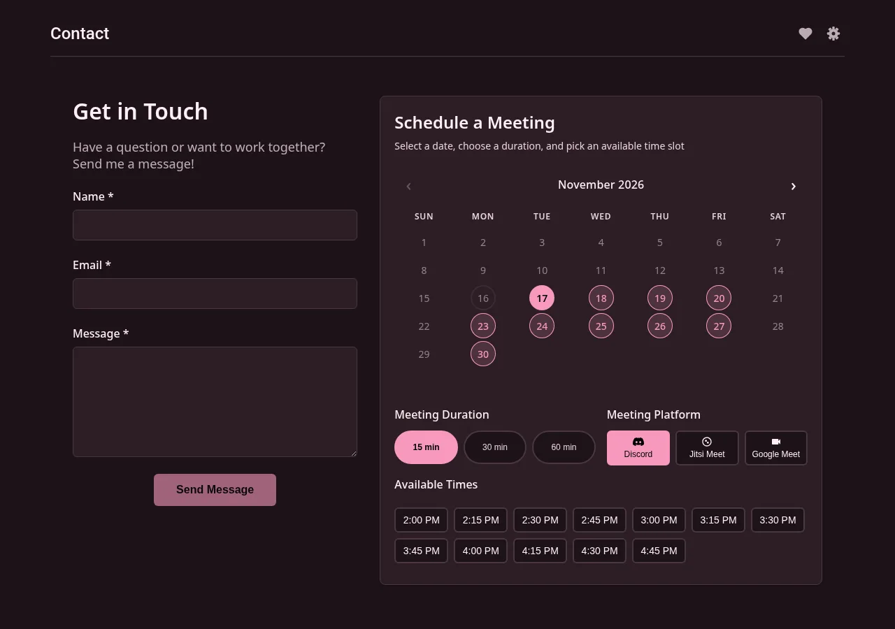

# Contact & Booking

Send a message, or book time, at [hadoku.me/contact](https://hadoku.me/contact).
No sign-in is needed: the form is open to anyone, and a booking gets a
confirmation email with a meeting link on whichever platform you picked.

The same package also ships the admin side: an inbox for the messages and
bookings that come in, a blocklist for mail nobody wants to see again, and a
narrow read surface other parts of the platform can use to confirm a message
really arrived.

- [Features](features.md): what each part does and how to use it.
- [Contributing](contributing.md): running it locally, the architecture, the checks it must pass.
- [History](history.md): from a mocked calendar to a reconciled mailbox.
- [Trivia](trivia.md)

## Trivia

The booking calendar you see today spent its first four months talking to a
fake backend: picking a slot in the November 2025 build saved nothing at all,
anywhere, until the real scheduling API arrived in March 2026
([history](history.md#from-a-mock-to-a-real-backend-march-2026)).
